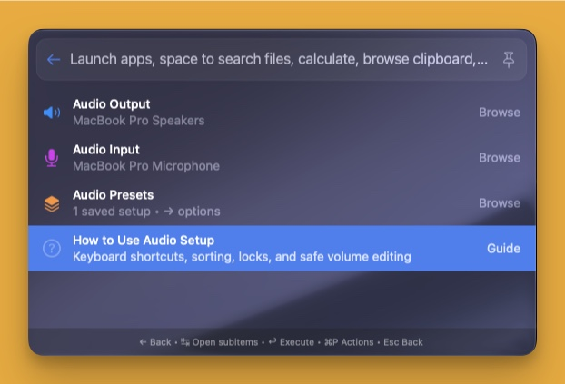

# Audio Setup

**Version 1.0.0 · by LoaySax**

Switch speakers and microphones, save your favorite audio setups, and manage presets from the BetterTouchTool Launcher.

## Features

- **Audio Output and Audio Input:** browse connected devices with transport, active-device, mute, and volume status.
- **Smart sorting:** active devices first, followed by default-locked devices, volume-pinned devices, built-in devices, and other devices. Names are sorted naturally within each group.
- **Default-device locks:** restore a preferred device after an external switch. A manual switch through this plugin pauses the affected default-device lock for 60 seconds.
- **Reusable presets:** save an output device, an input device, or both.
- **Preset management:** switch, rename, show/hide at top level, duplicate, update from current devices, or delete.
- **Additional audio controls:** adjust volume or microphone gain, mute, and optionally pin a level on supported devices.
- **Safer changes:** update and delete require confirmation; Cancel is the default keyboard action.
- **Session Undo:** reverse up to 10 preset edits, including creation, duplication, renaming, updating, and deletion. Undo restores saved configuration, not live audio routing.
- **Top-level shortcuts:** show the Output/Input/Presets sections or individual presets directly in a selected launcher. Visibility is stored separately for each launcher.
- **Live updates:** Core Audio listeners refresh device/default/volume/mute information. Lock enforcement also has a periodic fallback.
- **Built-in guide:** open **Audio Setup → How to Use Audio Setup** for navigation and behavior notes.

## Installation

1. Install BetterTouchTool.
2. Drag AudioSetup.swift onto the BetterTouchTool preferences window.
3. Review and approve BetterTouchTool's compilation/loading prompt.
4. Open your BTT Launcher and search for **Audio Setup**.

Only AudioSetup.swift is installed. The other files describe this release.

### Requirements and compatibility

- macOS with a BetterTouchTool version supporting the launcher plugin and native surface APIs used by this source.
- Source compilation was verified against the header shipped with **BetterTouchTool 6.992**.
- The oldest compatible BTT/macOS versions have **not** been established; the manifest intentionally leaves the minimum BTT version as TBD.
- No third-party Swift packages, external command-line audio utilities, or network services are required.

## Usage

### Devices

Open **Audio Output** or **Audio Input**, then choose a device to browse its controls:

1. **Switch to This Device** / **Currently Active**
2. **Output Volume** / **Microphone Gain**
3. **Mute / Unmute**, when software mute is supported
4. **Pin Current Volume / Unpin Volume**, when available
5. **Lock / Unlock Default Device**

Controls are capability-dependent. Hardware-managed volume is labelled as such rather than presented as an adjustable software control. Selecting an already-active device does not rewrite its routing.

### Presets

Open **Audio Presets → New Preset…**, enter a name, and save the current device combination.

- **Enter:** switch to the selected preset.
- **Right Arrow:** open the preset's management options.
- **⌘R:** rename.
- **⌘D:** duplicate.
- **Show at Top Level:** add a shortcut in that launcher; this is not an audio lock.
- **Update from Current Devices…:** review the current output/input before replacing the saved combination.
- **Delete Preset…:** confirm deletion, then use the Undo row in Audio Presets if needed.

Presets shown at top level are sorted first; active setups are prioritised within the applicable group, followed by natural name sorting. A preset with no saved device for one direction leaves that direction unchanged.

### Optional level adjustment

Adjust the slider or enter a percentage, then choose **Apply Volume**. Changes are not applied until you confirm. **Keep this volume pinned** optionally restores the saved level; leaving without applying discards your edits.

## What's new in 1.0.0

Initial publication of the redesigned Audio Setup plugin:

- Consistent native icons, status labels, useful sorting, and right-arrow preset management.
- Preset duplication, confirmation dialogs, bounded-name validation, and a 10-change session Undo history.
- Per-launcher top-level visibility, non-recycled preset IDs, and cleanup of deleted shortcuts.
- Accurate partial-failure reporting when only one direction of a preset switches successfully.
- Event-driven updates and safer Core Audio string ownership and multi-channel write handling.
- Standard macOS rename dialogs with protection against a held opening Return key.
- A native, built-in usage guide.

## Privacy and system effects

This is a native Swift plugin running inside BetterTouchTool's process.

- **Reads:** connected audio device names, persistent device identifiers, capabilities, default routing, volume, and mute state through Apple's Core Audio APIs.
- **Writes:** changes default input/output devices, volume/gain, or mute through the relevant controls or configured locks/pins.
- Output switching also attempts to set the system-alert output device after the main output switch succeeds. Some drivers do not support that secondary change.
- Saved presets, device identifiers, launcher visibility, lock targets, pinned volumes, and grace periods are stored in local UserDefaults under com.loaysax.btt.set-audio-device.
- Undo history is held in memory and is lost when this plugin instance is reloaded.
- While loaded, configured locks and volume pins can reapply saved settings without another button press. Unlock/unpin them if you do not want restoration.
- No network requests, telemetry, clipboard access, shell commands, AppleScript, microphone recording, or audio-content capture are performed.
- There is no external data transmission. The gallery's manifest permission is user-defaults; Core Audio system effects are documented here because the gallery has no dedicated audio-control permission label.

## Safety and limitations

- Increasing speaker volume or microphone gain can be loud; review the number before applying.
- Some devices expose neither software volume nor mute. Available controls depend on the device/driver.
- A disconnected preset device is reported, and available directions may still switch. Partial success is reported as a failure with an explanation; switching is not transactional and does not roll back a direction that already succeeded.
- A failed multi-channel write may have changed some channels before failure. The plugin reports the failure rather than claiming complete success.
- On channel-only volume devices, the plugin writes the same scalar level to each settable channel; this is not a balance editor.
- Core Audio listeners and the 30-second fallback provide best-effort restoration, not a real-time audio guarantee. Repeated restoration attempts are throttled.
- Bluetooth profile changes, physical hot-plugging, sleep/wake behavior, and every device/driver combination have not been end-to-end tested.
- The supplied screenshot shows the actual plugin's navigation, not every editor or device capability.

## Validation

- The source was compiled against BTT's actual native header during development.
- Development included **88 isolated runtime checks** using native API adapters, isolated preferences, and mocked audio writes, plus visual inspection of native editor/guide previews.
- Those checks are not equivalent to physical device-switching tests or a comprehensive security audit.
- Current package-validation results and hashes are kept in a private local release report, outside this distributable folder.

## License

MIT License. Copyright (c) 2026 LoaySax. See [LICENSE](LICENSE).

## Author

**LoaySax** · [GitHub](https://github.com/loaykhalifa)
