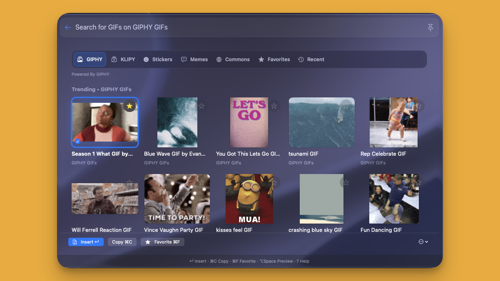
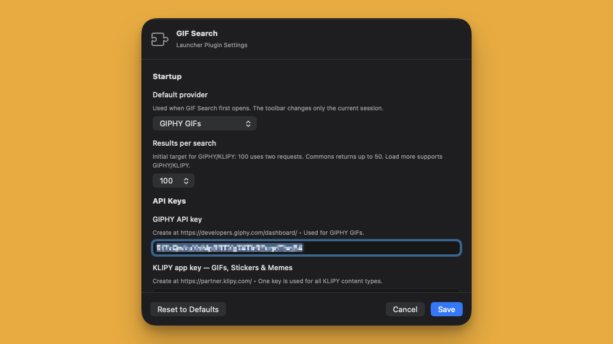
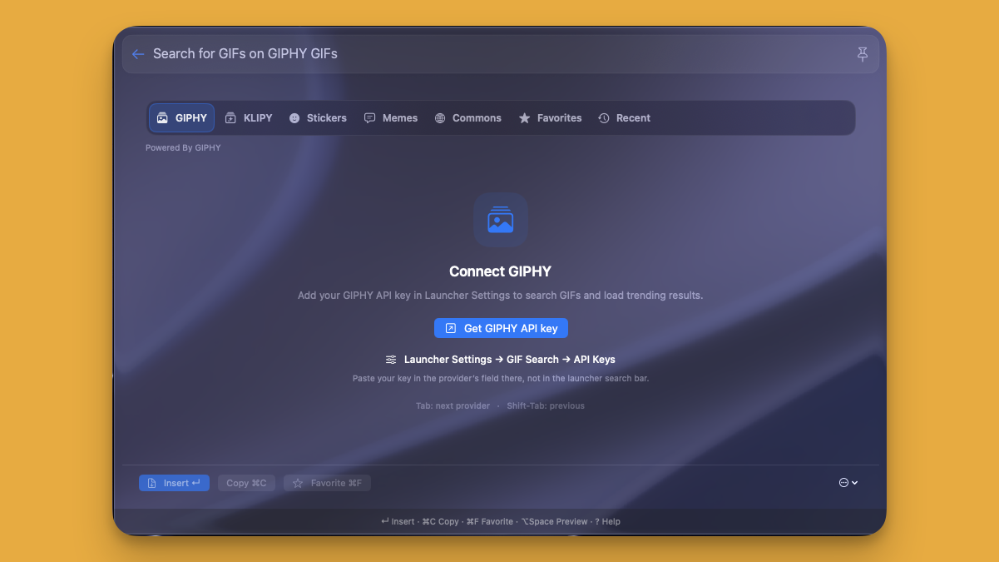

# GIF Search

Find GIFs, stickers, and memes without leaving BetterTouchTool Launcher. Preview an item, save it to Favorites, or insert it into the app you’re using.

## Screenshots

## Features

- GIPHY GIFs and KLIPY GIFs, stickers, and memes
- Wikimedia Commons GIF search with no API key
- Animated previews and a larger preview window
- Favorites, collections, and recently copied items
- Keyboard navigation and quick insert/copy actions
- Configurable default provider and result count
- Import and export your saved-item references

## What you need

- BetterTouchTool 6.992 or newer is recommended.
- An internet connection to search and download media.
- Your own GIPHY API key or KLIPY app key to use those providers.
- Apple Command Line Tools if BetterTouchTool asks for them during installation.

You can use **Wikimedia Commons without an API key**.

## Install

1. Drag **GIFSearchLauncherPlugin.swift** onto the BetterTouchTool preferences window.
2. Approve **Compile & Load** when prompted. Follow any prompt to install Apple Command Line Tools.
3. Open **Launcher Settings → GIF Search**.
4. Choose your default provider and preferred number of results.
5. For GIPHY or KLIPY, enter your own key under **API Keys**.
6. Open BetterTouchTool Launcher, search for **GIF Search**, and open it.

### Set up a provider

  
  

| Provider | Content | Setup |
|---|---|---|
| GIPHY | GIFs | Get a key from the [GIPHY developer dashboard](https://developers.giphy.com/dashboard/). |
| KLIPY | GIFs, stickers, and memes | Get an app key from the [KLIPY Partner Panel](https://partner.klipy.com/). The same key works for all three tabs. |
| Wikimedia Commons | GIF files | No key needed. Choose Commons and type a topic to search. |

Enter keys in **Launcher Settings → GIF Search → API Keys**, not in the search bar. Provider account requirements, approval, quotas, and terms apply.

## Find and insert media

1. Open GIF Search from the app where you want to insert media.
2. Choose a provider tab.
3. Type a search phrase in the Launcher search bar. GIPHY and KLIPY also show trending results when the search is empty.
4. Select an item with the mouse or arrow keys.
5. Press **Return** or choose **Insert** to send it to the previous app.

Use **Copy** if you prefer to paste the media yourself. Use **Favorite** to save an item for later.

### Keyboard shortcuts

| Shortcut | Action |
|---|---|
| Tab / Shift-Tab | Next / previous provider |
| Arrow keys | Move selection |
| Return / Enter | Insert selected media into the previous app |
| ⌘C | Copy selected media |
| ⌘⇧C | Copy the item’s source link and close Launcher |
| ⌘F | Add or remove a favorite |
| ⌥Space | Open the large preview |
| ? | Show shortcut help |

## Favorites and collections

Open **Favorites** to find saved items or **Recent** to revisit copied media. Use the action bar or actions menu to manage collections and import or export saved-item references.

Favorites and Recent save references, not offline copies of the media. An internet connection and the corresponding provider key may be needed to load them again. Exported references do not include API keys or media files.

## Settings

In **Launcher Settings → GIF Search**, you can choose the default provider, enter provider keys, and select 24, 50, or 100 results.

GIPHY and KLIPY return up to 50 items per page; choosing 100 uses two requests. Use **Load more** when available. Commons returns up to 50 items per search and requires a search phrase.

The actions menu also provides provider connection testing, animation controls, and an option to remember the last provider.

## Troubleshooting

**No results from GIPHY or KLIPY?**

Check the key in the plugin settings and use the connection test. Provider quotas, account permissions, and temporary service issues can affect results.

**Commons is empty?**

Type a topic in the search bar. Commons does not show trending results.

**An inserted GIF appears as a still image?**

Animation support depends on the receiving app. Some stickers and memes are static PNG images. Try Copy and paste manually, or use the source link.

**Insert does not paste?**

Open GIF Search from the intended destination app and try again. Ensure BetterTouchTool has Accessibility permission in macOS System Settings. Insertion is cancelled if the clipboard or destination window changes during preparation. Sending a paste command does not guarantee the receiving app accepts the media.

**A download fails?**

The item’s link may remain on the clipboard. Media downloads are limited to 32 MiB; unavailable files, timeouts, or restricted redirects can prevent copying.

## Privacy and permissions

- Searches go directly from your Mac to the selected provider. The provider receives your search, key when required, IP address, and normal request metadata.
- Previews and media are downloaded over HTTPS from provider-supplied URLs. Requests use an ephemeral session without a persistent URL cache or cookie storage.
- Provider keys are saved by BetterTouchTool in ordinary configuration fields, **not Keychain**. Keep settings, exports, backups, and screenshots containing keys private.
- The plugin writes to the clipboard and checks its change counter. It does not read existing clipboard text or media.
- Insertion tracks the destination app and focused window using Accessibility APIs, then requests ⌘V. It does not read document text.
- Saved-item references and preferences are stored locally. Media previews use a bounded memory cache, not a persistent offline library.
- Swift plugins run inside BetterTouchTool with its permissions. This plugin does not run shell commands or AppleScript.

## Media rights

GIF Search is not endorsed by BetterTouchTool, GIPHY, KLIPY, or Wikimedia. Provider terms and individual media rights apply.

For Commons items, use **File & license** to review the creator and license, and **Copy attribution** when needed.
