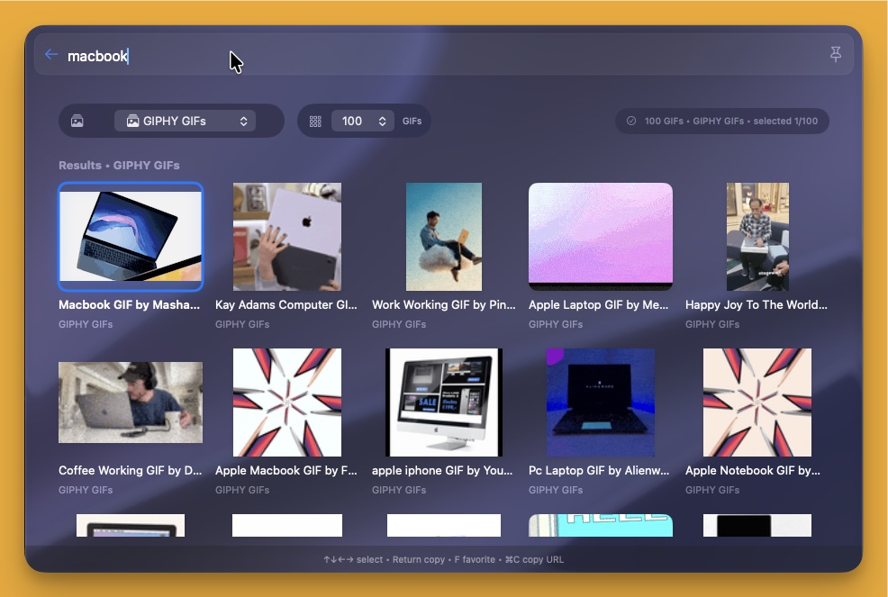

# GIF Search — BetterTouchTool Launcher Plugin

Search and copy GIFs from a native Swift surface inside BetterTouchTool Launcher.

## Features

- GIPHY GIFs, GIPHY Clips, Klipy, and Finer Gifs Club
- Animated preview grid with mouse and keyboard selection
- Favorites (up to 200) and recent copies (up to 80), stored locally
- Select 24, 50, or 100 results
- Copy media or its original GIF URL to the clipboard
- Configurable default provider
- Does not keep the Launcher pinned

## Requirements

- BetterTouchTool with Swift Launcher plugin and launcher surface support
- Internet access for online results and media
- Apple Command Line Tools if BTT requests them for compilation

Exact minimum macOS and BTT versions have not been verified for this package.

## Installation

1. Copy `GIFSearchLauncherPlugin.swift` to `~/Library/Application Support/BetterTouchTool/Plugins/`.
2. Restart BetterTouchTool or wait for its Swift plugin watcher to reload.
3. Open BTT Launcher, search for **GIF Search**, and open the result.

## Usage

Choose a provider from the Service dropdown and enter a search in the Launcher search field. GIPHY and Klipy can show results with an empty query; Finer Gifs Club requires a search term. Use Favorites or Recent to browse saved items. The result-count dropdown requests 24, 50, or 100 results; actual counts depend on the provider.

| Control | Action |
|---|---|
| Arrow keys | Move selection |
| Click a preview | Select an item |
| Return / Enter | Copy selected media and close the Launcher |
| F | Toggle selected favorite |
| Command-C | Copy selected original GIF URL and close the Launcher |

Return initially puts a URL on the clipboard, then downloads the selected media and replaces the clipboard contents with media data plus its URL. A failed download leaves the URL available. GIPHY Clips may copy video rather than GIF data. Paste support varies between applications.

## Privacy and external services

Search terms are sent to a third-party search proxy for GIPHY/Klipy or to the Finer Gifs Club API. Previews and selected media are downloaded from provider-supplied URLs. Favorites, recent items, and result-count preferences are stored locally in UserDefaults. Copying replaces the system clipboard. Swift plugins run with BetterTouchTool permissions; review the source before installation.

## Limitations and publication checklist

- The current implementation depends on third-party search endpoints for GIPHY and Klipy. Confirm permitted third-party use and service terms before publishing; these endpoints may change or stop working.
- No provider API-key settings are exposed by this implementation.
- No pagination is implemented beyond the selected result limit.
- Runtime installation, provider availability, and clipboard behavior have not been retested as part of packaging.
- Screenshot paths are relative to this folder and display directly on GitHub.
- Package version `1.0.0` is an initial staging version; the Swift source does not declare a release version.
- No separate license is declared in this package; confirm applicable licensing with the repository maintainer during review.

## Files

- `GIFSearchLauncherPlugin.swift` — publication copy of the installed source (description text updated)
- `plugin.json` — gallery metadata, following the Media Downloader package structure
- `README.md` — documentation
- `thumbnail.jpg` — supplied screenshot converted to JPEG

## Credits

Prepared for loaykhalifa. BetterTouchTool, GIPHY, Klipy, and Finer Gifs Club are their respective owners’ products/services. This plugin is not presented as an official integration with those providers. Respect media rights and provider terms.
