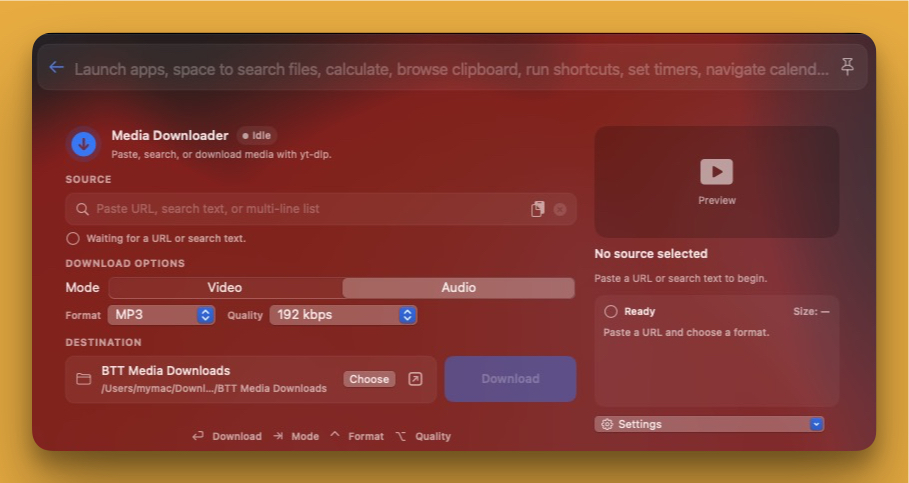

# Media Downloader — BetterTouchTool Launcher Plugin



A native Swift **BetterTouchTool Launcher** plugin for downloading video or extracting audio with [yt-dlp](https://github.com/yt-dlp/yt-dlp) and FFmpeg.

## Features

- Native one-page interface inside BTT Launcher
- Video and Audio modes with video presets, custom yt-dlp selectors, and MP3/M4A/WAV/Opus/FLAC output
- Thumbnail, title, channel/uploader, duration, and estimated-size preview (entry count for playlists)
- Live progress, transferred size, speed, ETA, playlist count, and queue count
- Direct URLs, plain-text YouTube searches, multi-URL queues, and multi-line search lists
- Playlist folders and timestamped folders for text-list queues
- Individual Spotify track links resolved to a YouTube audio search
- Configurable destination, browser cookies, tool checks, updates, and logs
- Downloads keep running when the Launcher closes; reopening it shows the live progress and Cancel still works
- Open or reveal the last downloaded file in Finder

## Screenshot


The repository screenshot is `screenshots/main.jpg`.

## Requirements

- macOS 12 or later
- BetterTouchTool with Swift plugin support
- Apple Command Line Tools if BetterTouchTool requests them for Swift compilation
- Homebrew with `yt-dlp`, `ffmpeg` and `ffprobe`, either on Apple Silicon (`/opt/homebrew/bin`) or Intel (`/usr/local/bin`)

Install dependencies with:

```bash
brew install yt-dlp ffmpeg
```

> Check Tools, Update Tools, previews and downloads all use the same lookup: `/opt/homebrew/bin` first, then `/usr/local/bin`. Tools elsewhere on your `PATH` are not used.

## Installation

1. Download or clone this plugin folder.
2. Copy `BTTMediaDownloader.swift` to:

   ```text
   ~/Library/Application Support/BetterTouchTool/Plugins/
   ```

3. Restart BetterTouchTool or wait for its Swift plugin watcher to reload the file.
4. Open **BTT Launcher**, search for **Media Downloader**, and open the result.
5. Enter a supported URL or search, select the output options, and choose **Download**.

## Usage

The Source field accepts a single HTTP(S) URL, plain search text, multiple URLs, multiple search lines, or an individual Spotify track link.

| Key | Action |
|---|---|
| Return / Enter | Start download |
| Tab | Switch Video / Audio mode |

When the Source field is empty and the launcher query has no URL, the plugin fills in a single URL from the clipboard. Lists of URLs or search lines are loaded from the clipboard only when you click the **Paste** button.

Choose browser cookies from **Settings** when a site requires authentication. Cookies are off (**None**) by default, the choice is remembered, and they are only used for the actual download, never for previews. Safari cookies are read through BetterTouchTool's Full Disk Access without a prompt; Chrome, Edge and Brave show a Keychain prompt to decrypt their cookies; Firefox cookies are read from its profile folder.

## Output

Default folder:

```text
~/Downloads/BTT Media Downloads
```

Single items use `Video Title - Channel Name.ext`. Playlists use `Playlist Name/Video Title - Channel Name.ext`. Multi-line text queues use a timestamped `Media Playlist …` folder.

Last log:

```text
~/Library/Logs/BTTMediaDownloader.log
```

## Tool management

- **Check Tools** checks Homebrew, yt-dlp, FFmpeg, ffprobe, internet access (a `curl` request to github.com), destination writability, and disk space.
- **Update Tools** uses an existing Homebrew installation to install or update yt-dlp and FFmpeg (`brew update`, `brew install`, `brew upgrade`). Homebrew only runs when you click this button.
- **Copy Log** copies the latest troubleshooting log.

The updater does not install Homebrew itself.

## Security and privacy

The plugin:

- Validates HTTP(S) targets and passes them to yt-dlp after an end-of-options marker
- Converts plain text to a `ytsearch1:` target instead of executing it as shell input
- Launches yt-dlp with structured `Process` arguments
- Reads the clipboard once when the surface opens, and only if the Source field is empty and the launcher query contains no URL. Only a single URL is taken automatically; lists are loaded only when you click **Paste**. Clipboard content never replaces text you typed or the launcher query.
- Writes to the clipboard only when you choose **Copy Log**
- Loads previews (title, channel, duration, thumbnail, size estimate) about 0.6 s after the URL stops changing, one URL at a time, and stops them when the Launcher closes. URLs you type or paste are previewed. A URL taken from the clipboard is previewed automatically only on youtube.com, youtu.be, music.youtube.com, vimeo.com, instagram.com, tiktok.com, facebook.com, fb.watch, x.com, twitter.com, soundcloud.com, twitch.tv, dailymotion.com, reddit.com, bilibili.com, open.spotify.com (and their subdomains); other clipboard URLs are filled in but not contacted until you edit them, click Paste, or start the download
- Never uses browser cookies for previews or size estimates. For playlists it only lists the entries (`--flat-playlist`) to count them.
- Downloads thumbnail images with a separate ephemeral session (no shared cookies or cache), a 10 s timeout and a 10 MB limit
- Contacts Spotify's oEmbed endpoint (ephemeral session) only when downloading a Spotify track link
- Passes browser cookies (`--cookies-from-browser`) only to the download itself, and only after you select a browser in **Settings**; the selection is remembered
- Writes downloads to the selected folder and logs to `~/Library/Logs/BTTMediaDownloader.log`
- Stores its settings (mode, formats, cookie browser, destination folder, last downloaded file) in BetterTouchTool's preferences domain under keys prefixed with `com.loay.btt.media-downloader.`; older `MediaDownloader.*` keys are migrated once and removed
- Runs Homebrew only when **Check Tools** (`brew --version`) or **Update Tools** is clicked
- Launches these processes: `yt-dlp` (previews, estimates, downloads), `ffmpeg`/`ffprobe` (via yt-dlp for merging and conversion, and `-version` in Check Tools), `brew`, `curl` and standard tools such as `df` and `awk` (Check/Update Tools scripts, run with `/bin/zsh -c` and an explicit `PATH`, not as a login shell), and `/usr/bin/pkill` (Cancel)
- On Cancel, sends SIGTERM to yt-dlp and its child processes (`/usr/bin/pkill -TERM -P`, no shell), then SIGKILL after 0.7 s if it is still running
- Keeps the download running when the Launcher closes; reopening the Launcher shows its progress and lets you cancel it

Review the Swift source before installation. Swift plugins run inside BetterTouchTool's process with its permissions (for example Full Disk Access and Accessibility).

## Limitations

- Supported services and formats depend on yt-dlp and the source website.
- DRM-protected media is not supported.
- Spotify support is limited to individual tracks and searches YouTube for a likely match.
- Estimated sizes may be unavailable or differ from final merged or converted output. Playlists show their entry count instead of a size.
- Closing BTT Launcher does not cancel an active download.

## Troubleshooting

1. Open **Settings → Check Tools**.
2. Install missing dependencies with `brew install yt-dlp ffmpeg`, or use **Update Tools** if Homebrew is already installed.
3. Select browser cookies for authenticated sources.
4. Use **Copy Log** and inspect `~/Library/Logs/BTTMediaDownloader.log`.

## Files

- `BTTMediaDownloader.swift` — BetterTouchTool Swift Launcher plugin
- `plugin.json` — community/gallery metadata
- `README.md` — documentation
- `screenshots/main.jpg` — screenshot

## Disclaimer

Only download media you own, created, or have permission to download. Respect copyright law and each platform's terms of service.

## License

MIT
