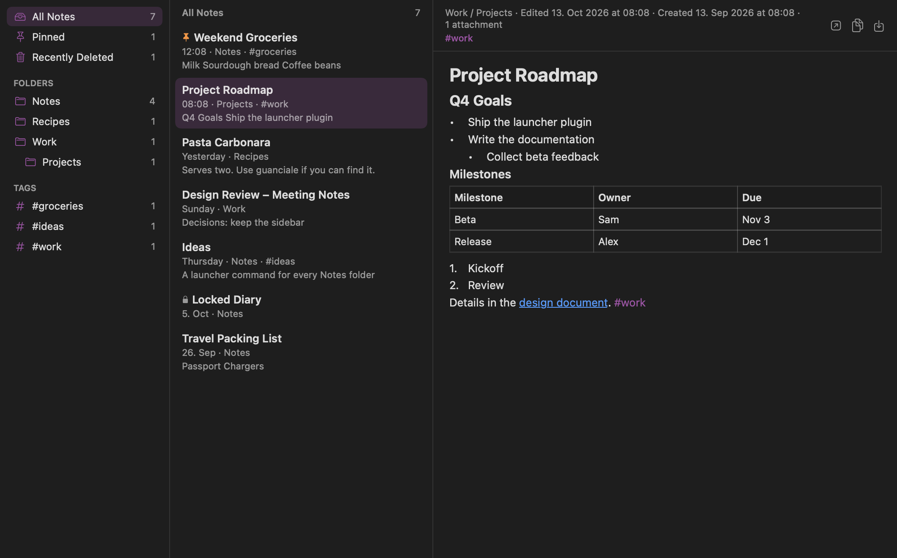
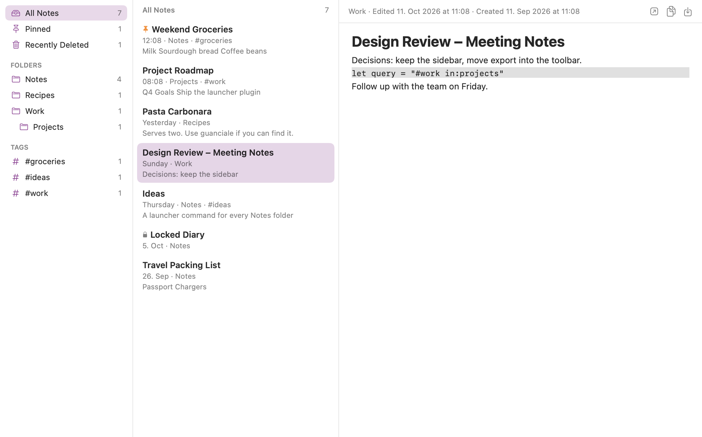

# Apple Notes

Search, preview, export and create Apple Notes from the BetterTouchTool launcher.

## Details

- Type: `Launcher`
- Main file: `AppleNotesLauncherPlugin.swift`
- Minimum BetterTouchTool version: `TBD`
- Author: folivora.AI

## Screenshots




The screenshots show the synthetic library from `Tests/make_fixture_library.py`.

## Features

- **Launcher results.** Typing a note title shows matching notes next to apps and
  commands. Matches in note text appear with a snippet and rank below title
  matches.
- **Keyword search.** `notes ` or `n ` followed by a query searches all notes.
  `notes` on its own lists pinned and recent notes.
- **Filters.** Use them in any query or in the browser:

  | Filter | Meaning |
  |---|---|
  | `word "exact phrase" -excluded` | all words must match the title, text or tags |
  | `#tag` or `tag:name` | notes with a tag (prefix match) |
  | `in:folder` | folder path contains the text, including subfolders |
  | `is:pinned` `is:shared` `is:locked` `is:deleted` | note state |
  | `has:checklist` `has:todo` | any checklist / unchecked items |
  | `has:attachment` `has:image` `has:table` `has:drawing` `has:link` `has:file` `has:audio` `has:tag` | content |
  | `modified:7d` `created:2026-03` `after:2026-01-01` `before:yesterday` | dates (`h`, `d`, `w`, `m`, `y`, days, months, years) |
  | `sort:modified` `sort:created` `sort:title` `sort:relevance` | ordering |

- **Notes browser.** The "Search Apple Notes" row opens a three-pane surface with
  folders, tags, results and a rendered preview, including tables, checklists,
  images and drawings. ↑/↓ select, ↩ opens the note in Notes, ⌘C copies
  Markdown, ⇧⌘C copies plain text and ⌘E exports.
- **Note commands.** Preview (⌘Y), Copy as Markdown (⌘C), Copy Plain Text (⇧⌘C),
  Export as Markdown File (⌘E), Append Text (⇧⌘A), Move to Folder (⇧⌘M) and
  Delete Note (⌘⌫).
- **Markdown export.** Converts headings, lists, nested lists, checklists, block
  quotes, code blocks, tables, links, bold, italic, strikethrough, tags, images
  and drawings, with optional YAML front matter.
- **Create notes.** "Create Apple Note" (also `new note <title>`) asks for a
  title, Markdown text and a folder. Selected text pre-fills the text field.

## Settings

- Search keywords (default `notes, n`)
- Number of notes in regular results (0 turns inline results off) and after a keyword
- Whether regular results match note text or only titles
- Markdown export folder and YAML front matter
- Whether Recently Deleted notes appear in results
- Whether new notes are shown in Notes after creation

## How It Works

Reading never goes through Notes. The plugin opens
`~/Library/Group Containers/group.com.apple.notes/NoteStore.sqlite` read-only
(`SQLITE_OPEN_READONLY` plus `PRAGMA query_only`), decodes the gzipped protobuf
note format and the CRDT table format itself, and keeps an in-memory index. The
index reloads when the database or its write-ahead log changes. Column names
differ between Notes versions, so the plugin resolves them from the schema at
load time. Password-protected notes are listed by title only.

Every change goes through Notes' AppleScript interface, so Notes performs and
syncs it. The plugin never writes to the Notes database.

## Limitations

- AppleScript has no form for checklists, tags, tables or attachments. New notes
  get checklist items as `☐` bullets. Append is disabled for notes that contain
  checklists, tags, mentions or attachments, because AppleScript rewrites the
  whole note body.
- Pinning, tags, checklist toggling and tables are only available through Notes'
  Shortcuts actions, which third-party apps cannot call directly.
- Smart folders are not evaluated. Use the equivalent filters instead.

## Installation

Drop `AppleNotesLauncherPlugin.swift` onto the BetterTouchTool preferences window,
or copy it to:

```text
~/Library/Application Support/BetterTouchTool/Plugins/
```

BetterTouchTool will ask before compiling and loading the plugin. To search
notes, allow BetterTouchTool in System Settings › Privacy & Security › Full
Disk Access. The plugin shows a setup row with a shortcut to that pane when
access is missing.

## Safety Notes

- **File read:** reads the Notes library, its media folder and drawing preview
  images. This content stays in BetterTouchTool's memory and is never sent
  anywhere.
- **AppleScript:** runs `osascript` to show, create, append to, move and delete
  notes. Values are passed as script arguments, never inserted into script
  source. Delete moves the note to Recently Deleted, and only when you run the
  command.
- **File write:** writes Markdown exports to the configured folder and temporary
  script files to the system temporary folder.
- **Clipboard:** writes only when you copy a note.

## Tests

```sh
python3 Tests/run-tests.py                      # engine unit tests, synthetic data
python3 Tests/run-tests.py --plugin HEADER      # compile like BetterTouchTool
python3 Tests/run-tests.py --e2e HEADER --screenshots DIR
python3 Tests/run-tests.py --live               # local library, aggregate stats only
```

`HEADER` is BetterTouchTool's `BTTSwiftPluginHeader.h`. `--e2e` loads the
compiled plugin in a minimal host (`Tests/PluginHost.m`) against the synthetic
library from `Tests/make_fixture_library.py`.
